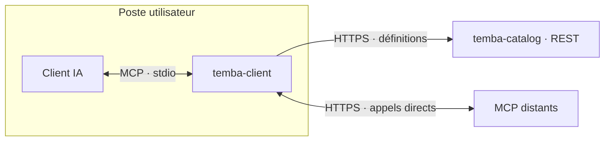

# Temba

**Un catalogue partagé de MCP. Des connexions qui restent sur votre poste.**

Temba permet à un assistant IA de découvrir et d’utiliser les outils de plusieurs
serveurs [MCP](https://modelcontextprotocol.io/), à partir d’une seule connexion locale.
Vous partagez un catalogue avec votre équipe ; chacun utilise ses propres accès aux services.

L’assistant dispose de deux outils : il **cherche** un outil adapté à votre demande,
puis **l’appelle**. Les adresses des MCP viennent du catalogue central. Leurs sessions
OAuth restent en mémoire sur votre poste.

[Premiers pas](#premiers-pas) · [Déployer le catalogue](#déployer-le-catalogue) · [Documentation](#documentation)

## Pourquoi Temba ?

- **Un catalogue pour l’équipe.** Les adresses et descriptions des MCP sont gérées au même endroit.
- **Des accès personnels.** Chaque utilisateur se connecte aux MCP avec son propre compte ou ses tokens.
- **Des outils à la demande.** L’assistant recherche les outils utiles avant de les appeler.
- **Un accès adapté aux utilisateurs.** Un MCP peut être public ou réservé à des groupes Keycloak.
- **Des ajouts ponctuels.** En option, l’assistant peut enregistrer un MCP dans son catalogue local éphémère.

## Comment ça fonctionne

Temba a deux composants, tous deux écrits en Rust :



Le **catalogue central** fournit les définitions des MCP et filtre leur visibilité.
Le **client local** récupère leurs outils, gère leurs connexions et les appelle directement.

Le catalogue ne reçoit pas les tokens OAuth des MCP et ne sert pas de proxy aux appels
métier. Ces tokens restent uniquement en RAM dans `temba-client` et disparaissent à son arrêt.

> Temba s’utilise avec un client IA capable de lancer un serveur MCP local en **stdio**.
> Le catalogue REST n’est pas lui-même un serveur MCP auquel connecter une interface web.

## Premiers pas

Ce parcours suppose qu’un catalogue est déjà déployé et que vous connaissez son URL.
Pour installer le vôtre, commencez par le [guide de déploiement](docs/DEPLOYMENT.md).

### 1. Récupérer le client

Installez [uv](https://docs.astral.sh/uv/getting-started/installation/), qui fournit la
commande `uvx`. Vous n’avez pas besoin d’installer Rust, Cargo ou un compilateur.

Récupérez ensuite le **wheel Temba adapté à votre système** auprès de votre administrateur
ou dans les artefacts de la [CI](.github/workflows/ci.yaml). Ce fichier `.whl` contient
le binaire Rust précompilé.

La CI cible Linux x86_64, macOS Apple Silicon et Intel, ainsi que Windows x86_64.
**Le package n’est pas encore publié sur un registre** : utilisez pour l’instant un fichier wheel.

### 2. Créer votre configuration

Copiez [temba.example.toml](temba.example.toml) dans un fichier `temba.toml`, puis indiquez
l’URL du catalogue. Pour commencer, ces deux lignes suffisent :

```toml
catalog_url = "https://catalogue.example.com"
labels = []
```

`labels = []` affiche les MCP sans label. Si votre équipe utilise des labels pour
rendre certains MCP optionnels, ajoutez ceux qui vous intéressent :

```toml
labels = ["support", "documentation"]
```

Les MCP sans label restent visibles. Un MCP qui porte plusieurs labels nécessite
qu’ils soient tous présents dans cette liste.

### 3. Brancher Temba à votre client IA

Le client doit lancer la commande suivante comme **serveur MCP local** :

```sh
uvx --from /chemin/absolu/vers/le-client.whl temba-client --config /chemin/absolu/vers/temba.toml
```

Remplacez les deux chemins par ceux de votre wheel et de votre configuration.
Utilisez des chemins absolus : le répertoire de travail du client IA peut changer d’un projet à l’autre.

<details>
<summary>Exemple de configuration OpenCode</summary>

Dans la configuration OpenCode, ajoutez une entrée MCP locale :

```json
{
  "mcp": {
    "temba": {
      "type": "local",
      "command": [
        "uvx",
        "--from",
        "/chemin/absolu/vers/le-client.whl",
        "temba-client",
        "--config",
        "/chemin/absolu/vers/temba.toml"
      ],
      "enabled": true
    }
  }
}
```

</details>

Dans un autre client MCP, reprenez cette même commande dans son format de configuration.
Pour vérifier seulement l’installation du binaire, vous pouvez lancer :

```sh
uvx --from /chemin/absolu/vers/le-client.whl temba-client --help
```

### 4. Faire une première demande

Lancez votre client IA et demandez par exemple :

> Liste les services auxquels tu as accès.

L’assistant utilise `tool_search` pour découvrir les outils, puis `call_tool` pour les exécuter.
Vous n’avez pas à manipuler leurs identifiants à la main.

Si une authentification est nécessaire, Temba ouvre le navigateur **lors de l’utilisation**.
Une session SSO déjà ouverte peut valider la connexion immédiatement : Temba attend brièvement
le résultat et poursuit la demande. Si une intervention reste nécessaire, l’assistant vous l’indique.

> Vous avez changé le TOML, des variables d’environnement ou la version du client ?
> **Redémarrez le processus Temba.** Avec un serveur IA persistant, comme `opencode serve`,
> relancer uniquement l’interface ne recharge pas forcément les MCP.

## Se connecter aux MCP

Les modes peuvent être combinés :

| Le MCP demande… | Ce que vous configurez |
| --- | --- |
| Aucun identifiant | Rien de plus côté utilisateur |
| Un token ou des headers privés | Leurs valeurs dans votre TOML ou dans l’environnement du processus Temba |
| Une connexion OAuth / OIDC | Une autorisation dans le navigateur ; la session reste en RAM |
| OAuth et des headers supplémentaires | Les deux mécanismes ensemble |

Pour un token statique, l’administrateur déclare le header attendu dans le catalogue.
Vous fournissez sa valeur localement. Par exemple :

```toml
[tool.service]
expected_endpoint = "https://mcp.example.com/mcp"

[tool.service.headers]
api_token = { env = "SERVICE_TOKEN" }
```

L’identifiant `service`, la référence `api_token` et l’URL doivent correspondre à la définition
du catalogue. Une valeur directe, comme `api_token = "Bearer …"`, fonctionne aussi ; gardez
alors ce fichier privé. Temba envoie la valeur complète, sans ajouter de préfixe.

Le guide [Configurer le client](docs/CLIENT.md) explique les headers, les labels et le déroulement des connexions.

### Faut-il Keycloak ?

**Non, Keycloak est optionnel.** Il sert à contrôler qui voit les entrées du catalogue partagé.
L’authentification d’un MCP distant reste indépendante : un catalogue public peut contenir des MCP OAuth.

Pour réserver des MCP à des équipes, suivez le [tutoriel Keycloak pas à pas](docs/KEYCLOAK.md).
Les labels sont un filtre de confort local ; les groupes Keycloak contrôlent la visibilité côté serveur.

## Ajouter un MCP pour un besoin ponctuel

Le catalogue local permet à l’assistant d’ajouter lui-même un MCP, sans modifier celui de l’équipe.
Activez-le dans votre TOML pour exposer le troisième outil, `add_mcp` :

```toml
[local_catalog]
enabled = true
idle_timeout_seconds = 1800
max_servers = 16
```

L’ajout reste **en mémoire dans le processus local**. Il reçoit un identifiant secret que
l’assistant doit présenter pour le retrouver et l’utiliser. Il fonctionne aussi sans authentification du catalogue central.

Chaque ajout expire après **30 minutes sans utilisation de son ID**, ou à l’arrêt du processus.
La limite par défaut est de **16 ajouts simultanés**. L’expiration est utile quand un serveur IA
conserve le processus Temba entre plusieurs conversations.

La possession de l’identifiant donne accès à l’ajout : ce n’est pas une authentification de conversation.
Les valeurs fournies à `add_mcp` peuvent également figurer dans l’historique du client IA.

Voir le [parcours d’ajout local](docs/CLIENT.md#ajouts-locaux-éphémères) pour les exemples et les règles OAuth.

## Déployer le catalogue

Vous administrez les MCP partagés ? Le catalogue se déploie avec une image conteneur et
la chart [temba-catalog](chart/temba-catalog). Vous y déclarez les adresses, les descriptions
et, si nécessaire, les groupes autorisés.

1. Construisez l’image et rendez-la accessible au cluster.
2. Préparez un fichier de valeurs Helm contenant vos MCP.
3. Déployez le catalogue, puis communiquez son URL aux utilisateurs.

Le [guide de déploiement](docs/DEPLOYMENT.md) déroule ces étapes, avec un parcours Minikube et les réglages pour un Ingress HTTPS.
Le [guide du catalogue](docs/CATALOGUE.md) explique comment décrire les MCP et administrer les ajouts persistants.

## Dans le dépôt

```text
crates/temba-client/     MCP local, recherche et connexions OAuth
crates/temba-catalog/    Catalogue REST et contrôle d’accès
crates/temba-core/       Schémas et validations communs
chart/temba-catalog/    Déploiement Kubernetes
docs/                  Guides d’utilisation et d’administration
```

Pour construire le projet ou les wheels, consultez le [guide de développement](docs/DEVELOPMENT.md).

## Documentation

| Vous voulez… | Lire |
| --- | --- |
| Configurer le TOML, des tokens ou les labels | [Client local](docs/CLIENT.md) |
| Décrire les MCP, leur OAuth et leurs headers | [Catalogue partagé](docs/CATALOGUE.md) |
| Installer le service et l’exposer | [Déploiement](docs/DEPLOYMENT.md) |
| Configurer les groupes et mappers Keycloak | [Tutoriel Keycloak](docs/KEYCLOAK.md) |
| Comprendre HTTP local, les NetworkPolicies et le stockage | [Options du catalogue](docs/CONFIGURATION.md) |
| Comprendre la protection des sessions locales | [Sécurité du client](SECURITY_CLIENT.md) |
| Comprendre le durcissement Kubernetes et du conteneur | [Sécurité du conteneur](SECURITY_CONTAINER.md) |
| Construire les wheels ou contribuer au code | [Développement](docs/DEVELOPMENT.md) |

Le [scénario Minikube](docs/MINIKUBE_TEST.md) décrit un environnement de test spécifique.
La [spécification V2](SPECIFICATION_TEMBA_V2.md) contient aussi des pistes d’évolution ;
les guides ci-dessus décrivent le comportement implémenté.
